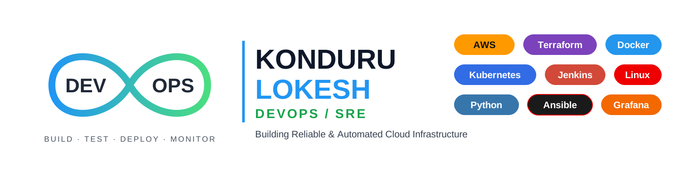

  
 <!-- Big animated heading: change size=40 to make it larger/smaller; raise width if text is cut off --> 
  
 <h3 align="center">DevOps / SRE Engineer | Cloud &amp; Automation</h3> 
  
 
   
 
   

🚀 About Me

Name: Konduru Lokesh

Role: DevOps/SRE

Experience: 3+ years

Location: Hyderabad, India 🇮🇳

Focus_areas:
  - Cloud Infrastructure (AWS / Azure / GCP)
  - CI/CD Automation & GitOps
  - Kubernetes & Containers
  - Observability & Incident Response
Currently_learning:
  - AIOps
  - AI/LLM Integration in DevOps Workflows
  - Platform Engineering
Currently_building:
  - AI-powered Case Summary Agent (FastAPI + AWS Lambda + LLM)
  - Automating support workflows with GenAI for faster incident triage
Ask_me_about: ["AWS", "Terraform", "Kubernetes", "DevOps"]

💼 Career Highlights
🏢 Virtusa Consulting Services 
🏢 Capgemini

⚡  99.9% uptime via Zabbix + Grafana monitoring

💰 15% AWS cost reduction through resource optimization

🚀 40% latency reduction on production workloads

🔐 25% fewer security risks via IAM hardening

📦 30% faster delivery with Jenkins CI/CD

🎯 95% SLA compliance on incident resolution

📈 GitHub Analytics

   
 
  

💡 DevOps Philosophy

"Infrastructure is code. Reliability is culture. Automation is freedom."

"Infrastructure is code. Reliability is culture. Automation is freedom."

🎯 Reliability	⚡ Automation	🔍 Observability	🔐 Security
SLOs over heroics	Toil → 0	Metrics, Logs, Traces	Shift-left mindset
✨ Let's Build Something Reliable Together!

